# As-Is Process — Order-to-Cash

**Document ID:** ASIS-01
**Version:** 0.1 (Draft)
**Phase:** 1 — Business Discovery
**Source documents:** `PRD.md` §1.2, §1.3, §3, §10; `Design.md` §2
**Status:** Draft — reconstructed from the PRD; not validated with process owners (`AS-14`)

---

## 1. Purpose and method

This document reconstructs how customer orders become cash today, before any ERP implementation. It defines the baseline against which the To-Be process will be designed and later tested.

**Method used:** documentary reconstruction from the baseline PRD, followed by structured gap analysis.

**Method limitation — stated plainly:** in a real engagement the As-Is would be built from interviews, observation (walk the floor), document sampling, and system extracts. None of that happened here. Each step below is therefore a *documented expectation* of how the process works, not an observation. Any detail not stated in the PRD is marked as a question rather than filled in.

This is deliberate. An As-Is process invented in detail is worse than an As-Is process with visible holes, because the invented detail silently becomes a requirement.

---

## 2. Process boundary

| Boundary element | Definition | Confidence |
|---|---|---|
| Trigger | A customer submits an order request (email or spreadsheet) | PRD §3 step 1 |
| Start point | Order receipt by Sales | PRD §3 step 1 |
| End point | Payment received, reconciled, and receivable considered closed | PRD §3 step 8 |
| Reporting tail | Management consolidates operational reports | PRD §3 step 9 |
| Upstream (excluded) | Procurement, inbound logistics, stock replenishment | `DQ-03` |
| Downstream (excluded) | Collection escalation beyond reconciliation, bad-debt write-off | `DQ-42` |
| Reverse flow (excluded) | Returns, cancellations, credit notes | `DQ-22` |

**Boundary caveat:** the PRD does not state whether returns or credit notes occur today. If they do, the As-Is is incomplete and the To-Be must include a reverse-flow branch (`DQ-22`). This is a scope risk, not a detail.

---

## 3. As-Is narrative

The current process consists of nine activities (`PRD §3`).

1. **Order intake.** Customers submit orders by email or spreadsheet. There is no standard order format, no validation at the point of receipt, and no acknowledgement that the order was received.
2. **Order recording.** A Sales representative manually records the order into a departmental record. Because the customer's format varies, the same order can be transcribed differently by different representatives.
3. **Customer and product checking.** Sales checks customer and product information. The check depends on the accuracy of locally maintained records; there is no unique, enforced identifier.
4. **Inventory checking.** Availability is checked against separate stock records. The check is a point-in-time read of data that may already be stale, and it does not reserve stock.
5. **Fulfilment instruction.** Warehouse receives fulfilment instructions through manual communication. The instruction is only as complete as the message; priorities and special handling depend on the sender remembering to include them.
6. **Shipment and delivery.** Logistics manages shipment updates separately. Delivery status lives in a logistics record that Sales and Finance do not see.
7. **Invoicing.** Finance prepares invoices using order and delivery information from other departments. Invoice accuracy depends on the timeliness and correctness of what Finance receives.
8. **Cash application.** Incoming payments are checked and reconciled manually. Matching a payment to an invoice relies on bank narrative, amount, and human judgement.
9. **Reporting.** Management consolidates operational reports from multiple sources. Because sources update at different times, two reports produced on the same day can disagree.

### 3.1 Handoffs — where the process actually breaks

The process is not nine steps; it is eight handoffs. Each handoff is a potential loss of information, time, or accountability.

| # | From → To | What crosses the boundary | Mechanism | Failure mode |
|---|---|---|---|---|
| H1 | Customer → Sales | Order request | Email / spreadsheet | Unstructured, incomplete, unacknowledged |
| H2 | Sales → Inventory | Availability request | Manual query | Stale answer, no reservation |
| H3 | Sales → Warehouse | Fulfilment instruction | Manual communication | Missing priority, wrong quantity, no priority record |
| H4 | Warehouse → Logistics | Ready-to-ship goods | Manual handover | Goods ready but not collected; no shared status |
| H5 | Logistics → Sales | Delivery status | Separate record | Sales cannot answer "where is my order?" |
| H6 | Logistics → Finance | Proof of delivery | Manual transfer | Invoice delayed or raised without proof |
| H7 | Finance → Customer | Invoice | Manual preparation and issue | Delay, wrong price, dispute |
| H8 | Customer → Finance | Payment | Bank credit notification | Unapplied cash, misallocation |
| H9 | All functions → Management | Performance data | Manual consolidation | Inconsistent figures, slow reporting |

Every handoff is also a **control point that does not exist**. No handoff carries a timestamp, an owner acknowledgement, or an exception record.

---

## 4. As-Is process diagram

```mermaid
flowchart LR
    subgraph CUST["Customer"]
        C1["Submit order<br/>email / spreadsheet"]
    end

    subgraph SALES["Sales"]
        S1["Record order manually"]
        S2["Check customer and<br/>product information"]
    end

    subgraph INV["Inventory"]
        I1["Check stock in<br/>separate records<br/>(no reservation)"]
    end

    subgraph WH["Warehouse"]
        W1["Receive manual<br/>fulfilment instruction"]
        W2["Pick and pack"]
    end

    subgraph LOG["Logistics"]
        L1["Arrange shipment"]
        L2["Update delivery<br/>status separately"]
    end

    subgraph FIN["Finance"]
        F1["Prepare invoice from<br/>order + delivery info"]
        F2["Reconcile payment<br/>manually"]
    end

    subgraph MGMT["Management"]
        M1["Consolidate reports<br/>from multiple sources"]
    end

    C1 --> S1 --> S2 --> I1
    I1 --> W1 --> W2 --> L1 --> L2 --> F1 --> F2 --> M1
```

**Reading the diagram:** the chain looks linear, but each arrow crosses a departmental boundary and a manual handoff (H1–H9 in §3.1). There is no return path for exceptions: an error discovered at invoicing travels backwards through informal conversation, not through the process.

**What is deliberately not shown:** approval steps, credit checks, partial deliveries, backorders, returns, and cancellations. The baseline documents do not state whether they exist (`DQ-16`, `DQ-22`, `DQ-26`, `DQ-45`). Drawing them would be invention.

---

## 5. Step detail

| # | Activity | Actor (per PRD) | Input | Record / system | Output | Handoff | Pain point |
|---|---|---|---|---|---|---|---|
| 1 | Submit order | Customer | Purchase intent | None (email/spreadsheet) | Order request | H1 | PP-03 |
| 2 | Record order | Sales Representative | Order request | Departmental spreadsheet | Recorded order | — | PP-01, PP-03 |
| 3 | Check customer and product | Sales | Recorded order | Separate reference records | Validated order (informal) | — | PP-01, PP-04 |
| 4 | Check inventory | Sales / Inventory (owner unconfirmed, `DQ-24`) | Recorded order | Separate stock record | Availability answer (no reservation) | H2 | PP-02, PP-04 |
| 5 | Instruct fulfilment | Sales (sender) → Warehouse | Validated order | Manual communication | Fulfilment instruction | H3 | PP-03, PP-04 |
| 6 | Pick and pack | Warehouse Operator | Fulfilment instruction | Warehouse record | Picked/packed goods | H4 | PP-03 |
| 7 | Ship and confirm delivery | Logistics Coordinator | Ready-to-ship goods | Logistics record | Shipment / delivery status | H5, H6 | PP-04, PP-06 |
| 8 | Prepare invoice | Finance / AR | Order + delivery information | Invoice record | Customer invoice | H7 | PP-01, PP-05 |
| 9 | Reconcile payment | Finance / AR | Bank credit + invoice record | Payment record | Matched payment | H8 | PP-05, PP-06 |
| 10 | Consolidate reports | Management | Multiple departmental reports | Manual consolidation | Management report | H9 | PP-06 |

**Actor uncertainty:** steps 4, 8, 9, and 10 have no explicitly named role in `PRD §3`. Actor labels above are the most reasonable reading of the PRD; they are flagged and carried as `DQ-24`, `DQ-36`, `DQ-41`, `DQ-54`.

---

## 6. Pain point register

Pain points are taken from `PRD §3.1`. Impact statements are **hypotheses**, since no measurement exists.

| ID | Pain point | Where it appears | Business impact hypothesis | Related problem | Evidence needed |
|---|---|---|---|---|---|
| PP-01 | Duplicate customer and product information | Steps 2, 3, 8 | Wrong price or terms applied; invoice disputes; wasted maintenance effort | PB-02 | Extract of existing records; duplicate count (`DQ-09`, `DQ-15`) |
| PP-02 | Limited inventory visibility | Step 4 | Over-commitment, missed delivery promises, emergency substitutions | PB-01 | Stock-out and order-cancellation history (`DQ-23`) |
| PP-03 | Manual departmental handoffs | Steps 1, 2, 5, 6 | Delay per handoff; rework when information is incomplete | PB-03 | Handoff timestamps, email volume (`DQ-19`, `DQ-28`) |
| PP-04 | Limited order traceability | Steps 3–7 | Slow exception resolution; no reliable answer to customer queries | PB-04 | Time to answer a status query (`DQ-31`) |
| PP-05 | Potential delays in billing | Steps 7–9 | Later cash collection; revenue recognition drift; dispute risk | PB-05 | Order-to-invoice elapsed time (`DQ-33`, `DQ-34`) |
| PP-06 | Inconsistent operational reporting | Steps 8–10 | Conflicting figures; slow decisions; low trust in reporting | PB-06, PB-07 | Two reports for the same period compared (`DQ-55`) |

**Note on PP-05:** the PRD says "potential" delays, not observed ones. It must stay worded that way.

---

## 7. Control gaps (inferred)

These are not in the PRD as a list; they are inferred from the documented manual process. They are framed as observations to validate, not as audit findings.

| ID | Control gap | Why it matters | Validate via |
|---|---|---|---|
| CG-01 | No system-enforced unique customer/product identifier | Duplicate records cannot be prevented, only cleaned after the fact | DQ-09 |
| CG-02 | No recorded approval evidence for commercial exceptions | Cannot demonstrate who approved what, when, or why | DQ-46, DQ-48 |
| CG-03 | No segregation of duties in shared spreadsheets | The same person can create, change, and reconcile a transaction | DQ-50 |
| CG-04 | No enforced traceability order → delivery → invoice → payment | Exception investigation depends on memory and email search | DQ-31, DQ-41 |
| CG-05 | No defined billing trigger | Invoice timing varies by individual practice; revenue timing is uncontrolled | DQ-33, BR-06 |
| CG-06 | No reconciliation control on cash application | Unapplied cash and misallocation remain invisible until ageing is reviewed | DQ-41, DQ-42 |
| CG-07 | No single KPI definition or reporting cut-off | Management cannot compare periods or functions reliably | DQ-54, DQ-55, NFR-08 |
| CG-08 | No audit trail with user identity and timestamp | `FR-15` cannot be satisfied; dispute resolution is unprovable | NFR-02, DQ-51 |

Each control gap maps to a functional requirement or non-functional requirement, which is how the To-Be design earns its justification. If a control gap is not real, the corresponding requirement loses its priority argument and must be re-justified rather than silently kept.

---

## 8. Baseline measurement plan

No baseline exists. The table defines what would be measured in week 1 of a real engagement, using existing records, before any design decision is locked.

| KPI | Definition (`PRD §10`) | Baseline available | Proposed measurement source | Owner |
|---|---|---|---|---|
| KPI-01 Order Cycle Time | Accepted order → agreed fulfilment milestone | No | Order records vs delivery records, manual sample | Sales Manager |
| KPI-02 On-Time Delivery Rate | Delivered by confirmed date / eligible delivered orders | No | Delivery records vs promised date | Logistics Coordinator |
| KPI-03 Order Fulfillment Rate | Quantity fulfilled / eligible quantity ordered | No | Order lines vs picked quantities | Inventory Controller |
| KPI-04 Billing Delay | Approved billing trigger → invoice creation | No | Delivery evidence vs invoice date | Finance Manager |
| KPI-05 Open Receivables | Invoice value not fully cleared at cut-off | No | Invoice and payment records | Finance Manager |
| KPI-06 Overdue Receivables | Open value past due date | No | AR ageing | Finance Manager |
| KPI-07 Order Exception Rate | Orders with exception status / total orders | No | Exception log (does not exist yet) | Sales Manager |

**Two consequences:**

1. The project cannot claim improvement. It can only claim a *measurable* design (`RSK-12`).
2. `KPI-07` cannot be baselined at all because no exception log exists. Building that log is itself a To-Be benefit, and it must be described as a new control, not an improvement over a known number.

---

## 9. Why the current process persists

A fair As-Is analysis explains why the current way survives, otherwise the To-Be design repeats mistakes.

- **It is flexible.** A spreadsheet accepts any customer format, any product, any price. An ERP will refuse some of these.
- **It is locally owned.** Each department can change its own record without a change request.
- **It has no visible cost.** The cost is distributed across individuals, so no single budget holder feels it.
- **It worked at a smaller scale.** The process was probably adequate before volumes and regions grew (`PRD §1.2`).

**Design implication:** the To-Be must replace flexibility with controlled exceptions. If the ERP simply forbids what spreadsheets allowed, users will maintain shadow spreadsheets — the single most predictable failure mode of this implementation (`RSK-09`, `RSK-14`).

---

## 10. What this document does not establish

| Not established | Why it matters | Tracked as |
|---|---|---|
| Actual cycle times per step | Cannot size the delay problem | §8, `DQ-19` |
| Volume of orders, lines, and SKUs | Cannot size NFR or warehouse design | `DQ-05` |
| Number of warehouses and locations | Determines stock model and delivery logic | `DQ-04` |
| Who physically performs step 4 | Availability control ownership | `DQ-24` |
| Whether approvals or credit checks exist today | Changes the As-Is completely | `DQ-45`, `DQ-46` |
| Whether returns and credit notes exist | Missing reverse flow | `DQ-22` |
| Which systems hold the "separate records" | Migration and integration scope | `DQ-08`, `DQ-53` |
| Any observed error or dispute rate | No evidence base for prioritisation | `DQ-15`, `DQ-42` |
