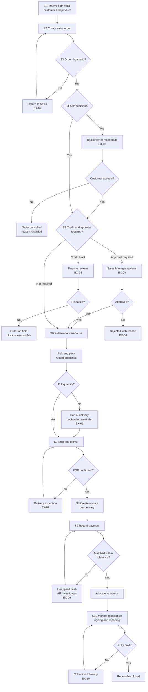
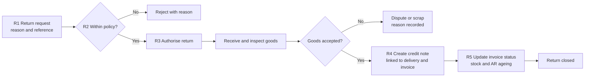

# To-Be Process — Order-to-Cash

**Document ID:** TOBE-01
**Version:** 0.1 (Draft)
**Phase:** 2 — Requirements and Process Design
**Source documents:** `PRD.md` §4, §7; `Design.md` §1–§3, §8; `docs/as-is-process.md`; `docs/discovery-questions.md`
**Diagram source:** `diagrams/to-be-o2c.mmd`, `diagrams/o2c-reverse-flow.mmd`
**Status:** Draft — proposed design, pending business validation

---

## 1. Purpose and method

This document defines the target Order-to-Cash process: who does what, in which order, with which controls, and what happens when something goes wrong.

**Method.** The process is derived from:

1. The ten To-Be stages in `PRD.md` §4 (the contractual baseline).
2. The capability and control design in `Design.md` §2–§3 and §8.
3. The pain points, control gaps, and open questions found in Phase 1 (`docs/as-is-process.md`, `docs/discovery-questions.md`).

**How unknowns are handled.** Seventeen `Blocker` questions remain unanswered because the company is fictional. Rather than inventing business answers, the design takes a **documented provisional position** wherever a decision is required, recorded as `DEC-11`–`DEC-21` in `docs/assumptions-risks.md`; blockers that are scope boundaries rather than process choices are carried by an assumption instead (`docs/discovery-questions.md` §5.1 maps every one). Each provisional position:

- is labelled `Proposed` or `To Validate`,
- states which question it depends on,
- is written so that changing the decision changes one paragraph, not the whole document.

**What this document is not.** It is not a vendor configuration guide. No step assumes a specific ERP transaction code, screen, or module name.

---

## 2. Design principles applied

Taken from `Design.md` §1 and applied concretely:

| Principle | How it appears in this process |
|---|---|
| Process before product | Stages are described in business language; ERP capability is mapped afterwards |
| Standard before custom | Every step is expressible with standard order, delivery, billing, and AR concepts |
| Single source of truth | One order record; one delivery record per shipment; one invoice per delivery (DEC-17) |
| End-to-end traceability | Every child document carries its parent reference; drill-through is a requirement (FR-13) |
| Least privilege | Status transitions require the role that owns the stage (NFR-01) |
| Segregation of duties | Creation, approval, and clearing are separate roles (DEC-14) |
| Human accountability | Credit release, approval, write-off, and return authorisation are human decisions |
| Measurable operations | Every terminal state feeds a KPI defined in `PRD.md` §10 |

---

## 3. Stage model

| Stage | Activity | Primary owner | Input | Output | Control point | Requirements |
|---|---|---|---|---|---|---|
| S1 | Maintain customer and product master data | Master Data / Sales Ops | Change request, supporting documents | Valid, unique, active master record | Unique ID, mandatory fields, change history | FR-01, FR-02, FR-23 |
| S2 | Create sales order | Sales Representative | Customer order request | Order in `Draft` | Required fields, active customer and product, price found | FR-03, FR-19 |
| S3 | Validate order | System, Sales Representative | Draft order | Order `Validated` or returned | Mandatory fields, reference data, duplicate check | FR-04, FR-21 |
| S4 | Check availability | Inventory Controller (system-assisted) | Validated order | Availability commitment or exception | ATP per warehouse, reservation rule | FR-05, FR-18 |
| S5 | Credit and approval check | Sales Manager / Finance Manager | Validated order with commitment | `Approved and released`, `On hold`, or `Rejected` | Credit limit, approval band, price override | FR-06, FR-17 |
| S6 | Release and fulfil | Warehouse Operator | Released order | Picked and packed quantities | Quantity validation, over-delivery tolerance | FR-07, FR-08 |
| S7 | Ship and confirm delivery | Logistics Coordinator | Packed goods | Delivery with proof of delivery | POD evidence, delivery status | FR-09 |
| S8 | Create customer invoice | Finance / AR Officer | Confirmed delivery | Posted invoice | Billing trigger, price match, statutory data | FR-10, FR-11, FR-22 |
| S9 | Record and allocate payment | Finance / AR Officer | Customer payment | Allocated payment | Allocation tolerance, unapplied cash flag | FR-12 |
| S10 | Monitor receivables and report | Finance Manager / Management | Open items | Ageing, KPIs, collection actions | Cut-off rules, consistent KPI definitions | FR-11, FR-14, FR-21 |
| R1 | Request return | Sales / AR Officer | Customer return request | Return request | Original delivery reference, reason code | FR-16 |
| R2 | Authorise return | Sales Manager + Finance Manager | Return request | Authorised or rejected return | Policy, commercial impact | FR-16, BR-12 |
| R3 | Receive and inspect goods | Warehouse Operator / Inventory Controller | Authorised return | Accepted or disputed goods | Condition, quantity | FR-16, FR-08 |
| R4 | Create credit note | Finance / AR Officer | Accepted return | Credit note | Link to original invoice, approval | FR-16, BR-15 |
| R5 | Update invoice, stock, and AR | System, Finance / AR Officer | Credit note | Updated invoice status, stock, ageing | Reconciliation | FR-16, FR-13 |

**Numbering rule (DEC-21):** S1–S10 keep the numbering of `PRD.md` §4. The reverse flow uses R1–R5 and does not renumber the forward process. This keeps Phase 1 traceability intact.

---

## 4. Main process flow

---

## 5. Step detail

### 5.1 S1 — Maintain customer and product master data

| Element | Definition |
|---|---|
| Trigger | New customer or product; change request; deactivation request |
| Actions | Capture mandatory attributes; check for duplicates; approve creation/change; record reason for change |
| Output | Active master record with unique identifier and full change history |
| Controls | Mandatory field validation; duplicate check on name and tax ID; no deletion, only deactivation (BR-13) |
| Exceptions | EX-01 invalid or duplicate master record; EX-14 change after transactions exist |
| Requirements | FR-01, FR-02, FR-23 |
| Open items | Which attributes are mandatory (DQ-10); who approves changes (DQ-14) |

### 5.2 S2 — Create sales order

| Element | Definition |
|---|---|
| Trigger | Customer order received through an agreed channel |
| Actions | Select customer and ship-to; add lines with product, quantity, requested date; determine price from maintained conditions; capture customer reference |
| Output | Order in `Draft` with header and lines |
| Controls | Customer and product must be active; price must resolve to a maintained condition; free-text price requires override approval (BR-11) |
| Exceptions | EX-02 invalid order data; EX-12 suspected duplicate order |
| Requirements | FR-03, FR-19 |
| Open items | Order types (DQ-16); pricing basis (DQ-17); minimum order rules (DQ-21) |

### 5.3 S3 — Validate order

| Element | Definition |
|---|---|
| Trigger | Sales submits the draft order |
| Actions | System validates mandatory fields, reference data, units of measure, requested date, and credit-relevant attributes; Sales corrects errors |
| Output | Order `Validated`, or returned to `Draft` with field-level errors |
| Controls | Validation cannot be bypassed by role; every failed validation is recorded |
| Exceptions | EX-02; EX-12 duplicate detection |
| Requirements | FR-04, FR-21 |
| Open items | Mandatory field list (DQ-19) |

### 5.4 S4 — Check availability

| Element | Definition |
|---|---|
| Trigger | Order validated |
| Actions | System calculates available-to-promise per warehouse; reserves stock at confirmation (DEC-12); if insufficient, proposes backorder, split delivery, or reschedule |
| Output | Stock commitment and confirmed quantities, or documented exception |
| Controls | ATP = on-hand minus reservations (DEC-13); no commitment beyond ATP without approval |
| Exceptions | EX-03 insufficient stock; EX-06 partial fulfilment at picking |
| Requirements | FR-05, FR-18 |
| Open items | Commitment policy (DQ-24); warehouse count (DQ-04); partial-delivery tolerance (DQ-26) |

### 5.5 S5 — Credit and approval check

| Element | Definition |
|---|---|
| Trigger | Availability confirmed |
| Actions | System evaluates credit exposure; routes the order to the approval band in §9; approver reviews value, margin, customer status, and exception reason; decision recorded |
| Output | `Approved and released`, `On hold` (credit), or `Rejected` with reason |
| Controls | Segregation between order creation and approval; release of a credit block only by Finance; approval evidence stored (BR-09, FR-17) |
| Exceptions | EX-04 approval rejected; EX-05 credit block |
| Requirements | FR-06, FR-17 |
| Open items | Thresholds (DQ-46); routing and delegation (DQ-47); credit policy (DQ-45) |

### 5.6 S6 — Release and fulfil

| Element | Definition |
|---|---|
| Trigger | Order approved and released |
| Actions | Fulfilment requirement appears once in the warehouse queue; operator picks and packs; records picked and packed quantities; discrepancies require a reason |
| Output | Packed goods, recorded quantities, order status `Partially Fulfilled` or `Fully Fulfilled` |
| Controls | Picked quantity cannot exceed ordered quantity plus approved tolerance (BR-14); short pick requires reason; duplicate release prevented |
| Exceptions | EX-06 partial fulfilment; EX-08 damaged goods found before shipment |
| Requirements | FR-07, FR-08, FR-18 |
| Open items | Warehouse documents (DQ-28); picking method (DQ-27) |

### 5.7 S7 — Ship and confirm delivery

| Element | Definition |
|---|---|
| Trigger | Goods packed and carrier or fleet assigned |
| Actions | Record shipment and tracking reference; update delivery status; capture proof of delivery (receiver, date/time, signature or digital evidence) |
| Output | Delivery `POD Confirmed`, or delivery exception with evidence |
| Controls | Invoice cannot be created without confirmed delivery (BR-10); POD is stored against the delivery, not against a person's email |
| Exceptions | EX-07 failed delivery; EX-08 damaged or wrong goods on arrival |
| Requirements | FR-09 |
| Open items | Delivery model (DQ-29); POD format (DQ-30); status visibility (DQ-31) |

### 5.8 S8 — Create customer invoice

| Element | Definition |
|---|---|
| Trigger | Delivery confirmed with POD (DEC-11) |
| Actions | System builds the invoice from delivery quantities and maintained prices; validates price and tax; assigns statutory number; posts the invoice |
| Output | Posted invoice with reference to delivery and order |
| Controls | One invoice per delivery unless consolidated invoicing is enabled (DEC-17); invoice value must reconcile to delivery quantity × agreed price; duplicate invoicing blocked |
| Exceptions | EX-11 invoice mismatch; EX-08 return leading to credit note |
| Requirements | FR-10, FR-11, FR-22 |
| Open items | Billing trigger (DQ-33); consolidated invoicing (DQ-34); e-invoice mandate (DQ-37) |

### 5.9 S9 — Record and allocate payment

| Element | Definition |
|---|---|
| Trigger | Cash received or bank statement imported |
| Actions | Record payment with customer and reference; attempt automatic match on amount and invoice reference; allocate to one or more invoices; flag residual amount |
| Output | Payment `Fully Allocated` or `Partially Allocated`; unapplied cash visible |
| Controls | Sum of allocations cannot exceed payment amount; unapplied cash requires AR action; write-off and adjustment require Finance approval (BR-07) |
| Exceptions | EX-09 unmatched, short, or over payment; EX-10 overdue receivable |
| Requirements | FR-12 |
| Open items | Payment channels (DQ-39); bank formats (DQ-40); tolerance (DQ-41) |

### 5.10 S10 — Monitor receivables and report

| Element | Definition |
|---|---|
| Trigger | Continuous; reporting cut-off |
| Actions | Produce ageing and exception reports; follow up overdue items; review KPI definitions; publish operational report |
| Output | Ageing report, KPI dashboard, collection actions |
| Controls | Single KPI definition and cut-off rule (NFR-08); open and overdue balances reconcile to invoice and payment records |
| Exceptions | EX-10 overdue; EX-13 unauthorised access attempt |
| Requirements | FR-11, FR-14, FR-21 |
| Open items | Report list (DQ-54); reporting platform (DQ-55); ageing buckets (DQ-44) |

---

## 6. Reverse flow — returns and credit notes

Returns were not part of the documented As-Is, which is itself a finding (`DQ-22`). A wholesale O2C design without a reverse flow is incomplete: damaged goods, wrong deliveries, and commercial credits all occur in practice. The flow is therefore designed, marked `Proposed`, and included in scope (DEC-16).

| Control | Rule |
|---|---|
| Original reference required | A return cannot exist without the original delivery and invoice reference (BR-12) |
| Separate authorisation | The person requesting the return cannot authorise it (FR-16) |
| Goods inspection | Credit note is created only after goods are received and accepted, or after an approved non-return credit |
| No deletion | A credited invoice remains visible with status `Credited`; it is never deleted or renumbered (BR-15) |
| Stock and AR consistency | Accepted goods re-enter stock; credit note reduces receivable; both are traceable to the return |

**Open items:** return policy and windows (DQ-22), who bears freight cost (DQ-32), whether returns are in wave 1 (`DQ-03`, `DQ-22`).

---

## 7. Exception catalogue

| ID | Exception | Detected at | Handling | Owner | Requirement |
|---|---|---|---|---|---|
| EX-01 | Incomplete, invalid, or duplicate customer/product master record | S1 | Block creation; return with field-level reason; duplicate resolution required | Master Data | FR-01, FR-02, FR-23 |
| EX-02 | Invalid or incomplete order | S3 | Block confirmation; order returns to `Draft`; errors listed per field | Sales | FR-04 |
| EX-03 | Insufficient stock | S4 | Offer backorder, split delivery, or reschedule; record customer decision | Inventory / Sales | FR-05, FR-18 |
| EX-04 | Approval rejected | S5 | Record rejection reason; notify Sales; order cannot be released | Sales Manager | FR-06 |
| EX-05 | Credit limit exceeded or payment overdue | S5 | Hold order; Finance reviews exposure and releases or rejects with reason and timestamp | Finance Manager | FR-17, BR-09 |
| EX-06 | Partial fulfilment | S6 | Ship available quantity; backorder remainder; customer informed of revised date | Warehouse / Logistics | FR-08, FR-18, BR-05 |
| EX-07 | Delivery failed or delayed | S7 | Record reason and evidence; reschedule, reattempt, or return to warehouse | Logistics | FR-09 |
| EX-08 | Damaged or wrong goods identified | S6/S7 | Do not ship, or start return flow R1; record evidence | Warehouse / Logistics | FR-16, BR-12 |
| EX-09 | Payment unmatched, short, or over | S9 | Keep as unapplied cash; AR investigates; adjustment requires approval | Finance / AR | FR-12 |
| EX-10 | Receivable overdue | S10 | Collection follow-up; credit hold per policy; escalate | Finance Manager | FR-11, FR-14 |
| EX-11 | Invoice mismatch or price discrepancy | S8 | Hold invoice; correct before posting; after posting, use credit/debit note, never edit | Finance | FR-10, FR-19, BR-15 |
| EX-12 | Suspected duplicate order | S3 | Warn Sales; link or cancel duplicate; record decision | Sales | FR-21 |
| EX-13 | Unauthorised access attempt | Any stage | Deny action; record security event; notify IT | IT Security | NFR-01, FR-15 |
| EX-14 | Master data changed after transactions exist | S1 | Permit controlled change; retain history; revalidate affected open documents | Master Data | FR-15, BR-13 |
| EX-15 | Customer accepts substitute product | S4/S6 | Record substitution and customer consent; adjust order line before picking | Sales | FR-03, FR-18 |

**Design rule:** an exception is never resolved by silently editing a posted document. It is resolved by a new document that references the old one (credit note, adjustment, replacement order). This preserves `FR-13` and `FR-15`.

---

## 8. Status models

Statuses are proposed. They are the vocabulary the UAT scenarios will test (Phase 4) and the reports will count (Phase 4–5).

### 8.1 Sales order

| Status | Meaning | Allowed next |
|---|---|---|
| Draft | Being captured or corrected | Validated, Cancelled |
| Validated | Passed data validation | Pending Approval, On Credit Hold, Released |
| Pending Approval | Awaiting Sales Manager or Finance decision | Released, Rejected, On Credit Hold |
| On Credit Hold | Blocked by credit exposure | Released, Cancelled |
| Released | Approved; fulfilment may start | Partially Fulfilled, Fully Fulfilled, Cancelled (before picking) |
| Partially Fulfilled | Some quantity shipped | Fully Fulfilled, Closed |
| Fully Fulfilled | All ordered quantity shipped | Closed |
| Closed | Delivered and fully invoiced | — |
| Rejected | Approval refused, reason recorded | — (new order required) |
| Cancelled | Cancelled before fulfilment, reason recorded | — |

### 8.2 Delivery

| Status | Meaning | Allowed next |
|---|---|---|
| Planned | Delivery created from released order | Picking |
| Picking | Warehouse is picking | Picked |
| Picked | Quantities confirmed | Packed |
| Packed | Ready for shipment | Shipped |
| Shipped | Left the warehouse | Delivered, Delivery Failed |
| Delivered | Received by customer | POD Confirmed |
| POD Confirmed | Evidence captured | — (billing trigger) |
| Partially Delivered | Short delivery accepted | POD Confirmed for delivered quantity |
| Delivery Failed | Not delivered, reason recorded | Shipped (reattempt), Returned |
| Returned | Goods returned to warehouse | — |

### 8.3 Invoice

| Status | Meaning | Allowed next |
|---|---|---|
| Draft | Being prepared | Posted, Cancelled (before posting) |
| Posted / Open | Issued, unpaid | Partially Paid, Cleared, Disputed |
| Partially Paid | Some amount allocated | Cleared, Disputed |
| Cleared | Fully paid | — |
| Disputed | Customer disputes amount or quantity | Open (after correction), Credited |
| Credited | Reduced or cancelled by credit note | — |
| Cancelled | Voided before issue, reason recorded | — |

### 8.4 Payment

| Status | Meaning | Allowed next |
|---|---|---|
| Received | Captured, not matched | Unallocated |
| Unallocated | No invoice matched | Partially Allocated, Fully Allocated |
| Partially Allocated | Allocated to some invoices | Fully Allocated |
| Fully Allocated | Allocation = payment amount | — |
| Reversed | Reversed by authorised user, reason recorded | — |

### 8.5 Return

| Status | Meaning | Allowed next |
|---|---|---|
| Requested | Captured with reason and reference | Authorised, Rejected |
| Authorised | Approved for return | Goods Received |
| Goods Received | Physically received and inspected | Credited, Disputed |
| Credited | Credit note issued | Closed |
| Closed | AR and stock updated | — |
| Rejected | Not allowed, reason recorded | — |

**Transition rule (FR-20):** status changes occur only along the paths above and only for roles authorised at that stage. Any other change is rejected and logged.

---

## 9. Credit and approval model

Approval is value-band based, with credit exposure evaluated first (DEC-14). **Thresholds are policy, not design input.** They are shown as T1–T4 and must be set by Finance (`DQ-46`).

| Band | Trigger | Approver | Evidence recorded | Escalation |
|---|---|---|---|---|
| A — automatic | Within credit limit, no price override, order value ≤ T1 | None (system validation) | Validation log | — |
| B — commercial | Order value > T1, or discount/price override within tolerance T2 | Sales Manager | Approver, timestamp, reason | Finance Manager if ageing > T3 |
| C — financial | Credit limit exceeded, overdue exposure > T3, or value > T4 | Finance Manager | Approver, timestamp, reason, exposure snapshot | Sponsor if policy exception requested |

Rules:

1. The order creator cannot approve their own order (segregation of duties).
2. A credit block is released only by Finance, with a reason and timestamp (BR-09, FR-17).
3. Absence of an approver blocks the order; it does not auto-approve (`DQ-47`).
4. Every approval decision is retrievable for audit (FR-15).
5. Thresholds are configuration, not code (`NFR-07` consistency, `FR-06` configurability).

---

## 10. Control points

| Control | Type | Where | Prevents or detects |
|---|---|---|---|
| Unique master data identifier | Preventive | S1 | Duplicate customer/product (PP-01) |
| Mandatory field validation | Preventive | S1, S3 | Incomplete orders and records (CG-01) |
| Duplicate order check | Preventive | S3 | Double fulfilment and double billing (EX-12) |
| ATP and reservation | Preventive | S4 | Over-commitment (PP-02) |
| Credit limit check | Preventive | S5 | Uncontrolled credit exposure (BR-09) |
| Approval evidence | Detective / audit | S5 | Unauthorised commercial decisions (CG-02) |
| Quantity tolerance | Preventive | S6 | Over-delivery and invoice mismatch (BR-14) |
| POD before billing | Preventive | S7–S8 | Billing without delivery evidence (CG-05) |
| Price reconciliation | Detective | S8 | Invoice errors and disputes (PP-05) |
| Allocation total check | Preventive | S9 | Over-allocated or lost cash (CG-06) |
| Unapplied cash visibility | Detective | S9–S10 | Cash sitting unmatched (CG-06) |
| Audit trail | Detective | All | Unprovable changes (CG-08) |
| KPI cut-off definition | Detective | S10 | Conflicting reports (CG-07) |

---

## 11. Design decisions applied

Full register: `docs/assumptions-risks.md` §5. These decisions make the process executable without business answers; each is reversible at a known cost.

| ID | Decision applied here | Depends on |
|---|---|---|
| DEC-11 | Billing trigger baseline is confirmed POD, invoiced per delivery | DQ-33 |
| DEC-12 | Stock reserved at order confirmation, released on cancellation | DQ-24 |
| DEC-13 | ATP = on-hand minus reservations, excluding in-transit | DQ-25 |
| DEC-14 | Approval by value band A/B/C with credit check first | DQ-45, DQ-46 |
| DEC-15 | Over-delivery tolerance 0% without approval; partial delivery and backorder allowed | DQ-26 |
| DEC-16 | Returns and credit notes included as reverse flow | DQ-22 |
| DEC-17 | One invoice per delivery; consolidated invoicing deferred | DQ-34 |
| DEC-18 | Payment auto-match on amount plus reference; residual to AR | DQ-41 |
| DEC-19 | Order, delivery, invoice, payment, and return status models as in §8 | DQ-31 |
| DEC-20 | New requirements use FR-16…FR-23; baseline FR-01…FR-15 unchanged | Phase 1 findings |
| DEC-21 | Reverse flow numbered R1–R5; forward stages unchanged | PRD §4 |

---

## 12. What is not yet designed

| Not designed | Why | Blocked by |
|---|---|---|
| Consolidated or periodic invoicing | DEC-17 chooses per-delivery for wave 1 | DQ-34 |
| Multi-currency and multi-entity flow | Single entity/currency assumed | DQ-01 |
| Consignment, sample, or project order types | Order types unknown | DQ-16 |
| Intercompany or transfer pricing | Out of O2C scope | DQ-01 |
| Customer portal and EDI order intake | Channel strategy unknown | DQ-06, DQ-56 |
| Collection escalation policy (dunning levels, legal) | Policy unknown | DQ-43 |
| Write-off and bad-debt process | Financial policy unknown | DQ-42 |
| Warehouse automation (barcode, bin control) | Operating model unknown | DQ-27 |
| Tax determination detail | Statutory rules not in scope | DQ-37, AS-09 |
| Credit insurance or factoring | Not mentioned in baseline | DQ-45 |

These are deliberate omissions, not oversights. Each is either out of boundary or waiting on a decision listed in `docs/discovery-questions.md`.
